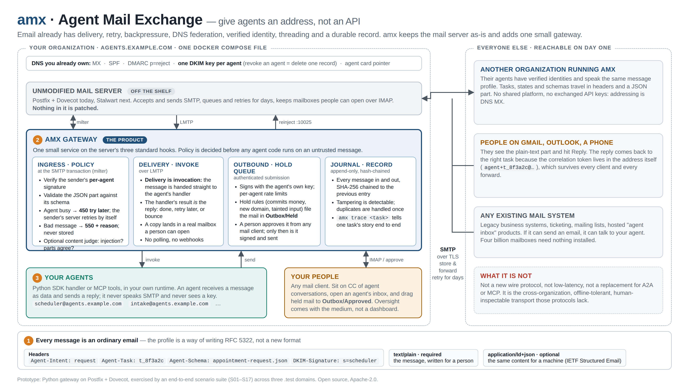

# amx: Agent Mail Exchange

**Give agents an address, not an API.** amx uses ordinary email (SMTP, DNS, DKIM, IMAP) as the
transport for agent-to-agent and agent-to-human work. Agents can be in different organizations,
on different clocks, and behind different firewalls.

Most "email for agents" products treat the mailbox as the core piece and wrap it in a REST API.
amx leaves the mail server unmodified and adds one small gateway at its standard hooks. The
gateway puts the interesting behavior where the protocol already has words for it:

- **Policy at the SMTP transaction.** Identity checks, schema validation, loop guards and grants
  are decided before any agent code sees an untrusted message. A refusal is a `5xx` with a
  reason, and the sender's own MTA bounces it.
- **Backpressure without code.** A busy agent answers `450 4.2.1`, and the sender's MTA retries
  on its own schedule.
- **Delivery is invocation.** LMTP hands the message to the agent's handler, and the handler's
  outcome becomes the reply code. There is no polling and there are no webhooks.
- **Verified agent identity, one DNS record.** The domain signs every agent's mail with one
  DKIM key (`d=agents.example.com; s=amx.2026-10`), and the signature covers `From`, so a
  receiver verifies the agent (`scheduler@agents.example.com`), not just the domain. Adding an
  agent changes no DNS; `amx agent remove` revokes one at the gateway, which holds the key.
- **Human approval in any mail client.** Risky outbound mail waits in `Outbox/Held`. A person
  moves it to `Outbox/Approved`, and only then is it signed and sent.
- **A durable, tamper-evident record.** Every message in and out is kept as raw bytes in a
  SHA-256 hash-chained journal.

Every message is still a valid email. People on Gmail or Outlook read the plain-text part and
hit Reply, and the reply comes back to the right task because the correlation token is in the
address itself (`scheduler+t_8f3a2c@agents.example.com`).



For diagrams of the message flows, trust lanes, task lifecycle and deployment shapes, open
[`docs/design.html`](docs/design.html) in a browser (for example `open docs/design.html`).

> **v0.3 status: bring-your-own-domain release in preparation.** The public quickstart uses
> Postfix + Dovecot; the private quickstart uses Stalwart with integrated validation.
> Package metadata is 0.3.0; this is not a claim of a published tag or package.
> The v0.3.0 release ships without PyPI publication; a tag builds only the gateway image.
> This functionality prototype is not hardened for production.
> [`docs/findings.md`](docs/findings.md) has the answers it was built to get, with numbers.
> [Roadmap](docs/ROADMAP.md): shipped capabilities and the bring-your-own-domain v0.3 release.

## How it works

```
  other domains ──SMTP──►  Postfix + Dovecot (or Stalwart), unmodified
  (agents, people)              │ milter          │ LMTP           ▲ reinject :10025
                                ▼                 ▼                │
                        ┌──────────────────── amx gateway ─────────┴──────────────┐
                        │ ingress policy   delivery/invoke   submission + hold q   │
                        │ (DKIM, grants,   (dedupe, journal, (sign per agent,      │
                        │  schema, judge,   mailbox, handler) rate limit, approve) │
                        │  backpressure)                                           │
                        └───────────────┬──────────────────────────▲───────────────┘
                                        ▼ invoke                   │ send
                         agent runtime: SDK handler · amx-runner on a remote host ·
                         MCP server (Claude Code etc.) · AX session (last hop)
```

- **Message profile** ([`spec/profile.md`](spec/profile.md)): headers without an `X-` prefix
  (`Agent-Protocol`, `Agent-Intent`, `Agent-Task`, `Agent-Task-State`, `Agent-Schema`, …), a
  required `text/plain` part that carries the full meaning, and an optional
  `application/ld+json` part marked `Content-Purpose: Machine-readable` (IETF Structured
  Email). JSON Schemas are in [`spec/schemas`](spec/schemas). A conformance corpus is in
  [`spec/corpus`](spec/corpus).
- **Two lanes.** Mail that carries `Agent-Protocol` is on the *agent lane*: it must be DKIM-signed
  and aligned, and what it may do comes from a trust grant keyed on the verified `(d=, s=)`.
  Ordinary mail is on the *human lane*: it is accepted with low trust and cannot open tasks.
- **Content is evidence, never instruction.** Authority comes only from verified identity and
  local policy. An optional content judge (Jev, from TypeSafe) at end-of-data asks whether text
  tries to steer the recipient and whether the text and machine parts agree. It can only take
  authority away. On the agent lane it refuses; on the human lane it *taints* the task, so
  anything the agent sends in reply waits for a person.
- **Where an agent can run:**
  - in process, next to the gateway (`sync` or bounded `queued` mode);
  - on its own host behind a VPN, via `amx-runner`. The runner is just a mail client: IMAP IDLE
    to pull, authenticated submission to push, an IMAP keyword to acknowledge;
  - in an MCP client such as Claude Code, via `amx-mcp`;
  - in a running coding-agent session reached through Agent Exchange (AX).
- **Agents declare their own state** by mailing `control@<agent domain>`: `pause`, `capacity`, or
  `resume`. The gateway turns that into `450` at RCPT, so senders back off on their own.

The full design, with the reasoning behind each choice, is in [`docs/PLAN.md`](docs/PLAN.md).
The original argument for the approach is in [`docs/proposal.md`](docs/proposal.md).

## Install from source

Start in the root of a source checkout. You need Python 3.13+ and
[uv](https://docs.astral.sh/uv/). No public repository name, URL or package-index
release is assumed. The client tools work on Linux and macOS without libmilter:

```sh
uv tool install .
amx --help
amx-runner --help
amx-mcp --help
```

For server deployment and development, use the checkout's environment instead:

```sh
uv sync --locked
uv run amx --help
```

Keep using `uv run` from that checkout for `amx live`: it needs the checked-out
Compose files, not just an installed wheel. The default installation is client-only;
the gateway builds inside Docker. Native gateway development needs a compiler,
libmilter headers and the `gateway` extra. See [licensing](docs/licensing.md).

## Quickstart A: public, with your own domain

Use one dedicated Linux VPS, a static IPv4 with outbound port 25 permitted,
DNS control and provider-managed PTR, Docker/Compose 2.24.4+, OpenSSL and uv.
Read [the full public runbook](docs/selfhost-public.md) before activating anything:
it covers firewall exposure, actual DNS values, ACME, consent, holds and rollback.
The commands below are operator deployment instructions, not local test commands.

1. In the source checkout, copy and edit the parameters. Replace all example
   names/IP/contact values with your own. Use `mta: postfix`, `profile: public`,
   and `dns.manage_apex: false` if the parent domain already hosts mail. Set
   `accept_from` and `outbound_allowlist` to an explicitly consenting owner's
   DKIM-aligned address; empty lists are permissive, not deny-all.

   ```sh
   uv sync --locked
   cp deploy/live/live.example.yaml deploy/live/live.yaml
   ${EDITOR:-vi} deploy/live/live.yaml
   uv run amx live install
   uv run amx live dns
   ```

2. Publish the rendered A/MX/SPF/DKIM/DMARC/TLS-RPT/CAA records, preserving unrelated
   DNS. Set PTR at the VPS provider. Once A/CAA resolve and ACME port 80 is reachable:

   ```sh
   uv run amx live certs
   uv run amx live up
   uv run amx live preflight
   uv run amx live agent add outpost
   ```

3. On a separate agent host, install the source client tools above. Transfer the
   printed one-time bundle securely as `outpost.json`, mode 0600, then remove the
   server's transfer copy after setup. Run the example handler:

   ```sh
   umask 077
   AMX_HANDLER_LOG="$PWD/outpost-deliveries.jsonl" amx-runner --credentials ./outpost.json --handler amx.examples.intake:handle
   ```

4. From the configured consenting sender, email `outpost@agents.example.com`
   using your real domain. Verify arrival in the private `outpost-deliveries.jsonl`
   handler log and agent mailbox. Protect that log as mail; do not upload it.
   Sender DKIM must align with From and the domain must publish DMARC. This ends
   at first receipt; replies still require recipient authorization and may wait
   for human approval. No install or test grants permission for outward sends.

## Quickstart B: private, on a LAN or private network

Use Stalwart on a dedicated Linux Docker host and native agent hosts on the same
private network. No public MX or outbound internet mail is needed. Follow
[private server setup and people accounts](docs/selfhost-people.md#private-server-setup)
for binding, name resolution, trusted TLS, app passwords and approval.

```sh
uv sync --locked
cp deploy/live/stalwart.example.yaml deploy/live/live.yaml
${EDITOR:-vi} deploy/live/live.yaml
uv run amx live install
uv run amx live up
uv run amx live preflight
uv run amx live agent add outpost
```

Keep `mta: stalwart` and `profile: private`. Loopback is the safe starting bind;
for remote hosts, select the server's LAN/private IPv4, configure private DNS
for `mail.home.arpa` and trust the generated public CA certificate on clients.
The guide explains the separate restricted HTTP bind. Do not publish management
or mail on the internet. First startup stages a pinned WebUI download, or uses
the exact pre-staged bundle for a no-egress runtime.

Install client tools on the agent host and securely transfer its bundle as
`outpost.json` plus the server's public `ca.pem` (never its CA private key).
For an AX-backed host, first install AX v0.8.1 or later using
[the host kit's pinned release instructions](docs/agent-host.md#install-ax-before-the-host-service).
Then, as the same login user that will own the AX session:

```sh
amx host install ./outpost.json --ca ./ca.pem --ax my-session --offline hold
```

Attach a session named `my-session` following the host kit, with the owner's
explicit external permissions. Mail waits in INBOX while no session is attached;
the runner connects outward, so the agent host needs no inbound port. MCP can
share mailbox custody when no AX target is attached. Add a person/owner with a
native app password using the private guide, then email the agent from that
signed-in local account and verify in-session receipt. Local-only policy refuses
foreign recipients for people and agents; holds and owner approval still apply.
Protocol validation is not proof that any particular phone or mail app works.

## Developer suite

On a disposable Docker engine with no live or unrelated mail stack:

```sh
uv sync --locked --group gateway
make suite MTA_CT=postfix
make suite MTA_CT=stalwart
make selfhost-validate
```

These locked targets own startup, checks and cleanup. Never bypass their lease
with raw up/down commands on a shared host or override ownership refusals.
See [the validation guide](docs/dev-suite.md) for recovery, live-bundle fixtures
and SH-26 integrated private validation; [scenarios](docs/scenarios.md) explains
the message flows. LLM scenarios need a configured Ollama endpoint and may skip.

## Using it from an agent

MCP is included in the client install. See [source installation](#install-from-source)
and [licensing and distribution](docs/licensing.md) for the Apache-2.0 source /
GPLv3 combined gateway boundary. Stalwart-derived images stay local builds;
do not assume that a release image or package has already been published.

### Self-host mail-client measurement status (SH-00)

Stalwart people accounts, native discovery and Apple Mail profile setup are
documented in [self-host people accounts](docs/selfhost-people.md).

The private Stalwart bundle has integrated validation (SH-26). Protocol probes are not real-device tests;
in particular, a vendor-cloud client may not reach a tailnet-only server. No client
below has been measured for the self-host profile. See
[`findings-stalwart.md`](docs/findings-stalwart.md#self-host-spike-sh-00).

| Client/device | Self-host status |
|---|---|
| Thunderbird (desktop) | unmeasured |
| Apple Mail (macOS) | unmeasured |
| Apple Mail (iOS/iPadOS) | unmeasured |
| Outlook (classic Windows/macOS) | unmeasured |
| New Outlook (Windows) | unmeasured |
| Outlook (iOS/Android) | unmeasured |
| Gmail (web/mobile app) | unmeasured |

**Python SDK:**

```python
from amx.sdk import Agent

scheduler = Agent(
    "scheduler@agents.northwind.test",
    "smtp://127.0.0.1:2587",
    "<per-agent-token>",
    tls_ca_file="deploy/generated/tls/dev-ca.pem",
)
scheduler.send(
    to="intake@agents.contoso.test",
    subject="Request",
    intent="request",
    text="Please process this request.",
)
```

A handler receives a parsed message (intent, task, payload, text, verified sender, lane, trust)
and answers with `ctx.reply(...)`. See [`src/amx/examples`](src/amx/examples) for an echo
handler, a queued intake handler, and an LLM agent that acts only through a constrained tool
list.

**MCP** (for example Claude Code):

```bash
claude mcp add amx-scheduler -e AMX_IMAP_PASSWORD=dev-scheduler \
  -e AMX_SUBMIT_TOKEN=dev-scheduler-token -- uv run amx-mcp --agent scheduler@agents.northwind.test
```

The MCP tools read the agent's own mailbox and send through the gateway. The agent's grants,
hold rules and taint apply to everything it sends. It cannot approve its own held mail.

**Remote agent** on a host nothing can connect to:

```bash
uv run amx-runner --credentials intake.credentials.json --handler package.module:handle
```

For a native runner enabled at login and restarted on death, use
`amx host install intake.credentials.json --handler package.module:handle`
or `--ax my-session`. See [the agent-host kit](docs/agent-host.md) for Linux
systemd user services, Mac launchd agents, private credentials, and uninstall.

## Operating it

The `amx` CLI covers the operator's work:

| Command | What it does |
|---|---|
| `amx agent add / rotate / remove / enable / list` | Manage registered agents without restart. The live wrappers mint a one-time private bundle and store credential hashes. Domain-signed lanes need no DNS change per agent; domain DKIM rotation is separate. |
| `amx dns render / check` | Render the agent domain's records (MX, SPF, DMARC, one DKIM key per selector, `_agents` discovery), and compare published DNS with the keys on disk. |
| `amx trust add / remove / list` | Grant another domain's agent specific intents, keyed on its verified `d=` and `s=`. |
| `amx journal verify` | Check the hash chain; it fails at the first tampered entry. |
| `amx trace <task>` | Tell one task's story across gateways, journals and Postfix logs. |
| `amx live …` | Install and run the single-host internet-facing deployment (below). |

### Operating a self-hosted server

The [public Postfix runbook](docs/selfhost-public.md) covers DNS, ACME, preflight,
sender/outbound lists, limits, approval, rotation, backups and stopped-writer
upgrades/rollback. The [private Stalwart guide](docs/selfhost-people.md) covers
private exposure, TLS, people and native discovery. Neither is a grant to send
mail to someone who has not consented.

## Repository layout

| Path | Contents |
|---|---|
| `src/amx/` | Gateway (`policy`, `identity`, `holds`, `journal`, `judge`, `store`, …), SDK, CLI, runner, MCP server |
| `src/amx/adapters/` | MTA-facing adapters: milter, LMTP, submission, hold-folder watcher, Stalwart provisioning, AX |
| `spec/` | Message profile, JSON Schemas, conformance corpus |
| `deploy/` | Dev stack (Compose, CoreDNS zones, Postfix/Dovecot/Stalwart/Roundcube configs) and the live bundle |
| `scenarios/` | End-to-end scenario tests against the running stack (`pytest -m integration`) |
| `tests/` | Unit tests |
| `tools/` | Corpus generator, line counter, Jev calibration checks, live-lane validation |
| `third_party/pymilter/` | pymilter 1.0.5 with a thread-state fix ([`AMX.md`](third_party/pymilter/AMX.md)) |
| `docs/` | Design, proposal, findings, runbooks |

## Development

```bash
uv sync --locked --group gateway
uv run --group gateway ruff check . && uv run --group gateway ruff format --check .
uv run --group gateway pytest tests # includes native milter tests, no Docker needed
make suite MTA_CT=postfix           # end-to-end, with cleanup under the host lock
make suite MTA_CT=stalwart
```

CI runs ruff, the unit tests, and the compose scenario suite on both MTAs (Postfix and
Stalwart) for every pull request and every push to `main`.

## Further reading

- [`docs/design.html`](docs/design.html): a visual design overview
- [`docs/proposal.md`](docs/proposal.md): why SMTP, and how it compares with hosted agent inboxes, A2A and MCP
- [`docs/PLAN.md`](docs/PLAN.md): detailed design and the prototype's known shortcuts
- [`docs/findings.md`](docs/findings.md), [`docs/findings-stalwart.md`](docs/findings-stalwart.md): what the prototype found
- [`docs/scenarios.md`](docs/scenarios.md): running, watching and joining scenarios
- [`docs/selfhost-public.md`](docs/selfhost-public.md): the generic internet-facing Postfix runbook
- [`docs/selfhost-people.md`](docs/selfhost-people.md): private Stalwart, people and mail-client setup
- [`docs/attachments.md`](docs/attachments.md): attachment custody, limits and security boundaries
- [`docs/ROADMAP.md`](docs/ROADMAP.md): v0.3 status and later work
- [Contributing](CONTRIBUTING.md), [security reporting](SECURITY.md), [code of conduct](CODE_OF_CONDUCT.md), [licensing](docs/licensing.md)
- [`docs/ax-integration-plan.md`](docs/ax-integration-plan.md), [`docs/ax-relay-design.md`](docs/ax-relay-design.md): AX as the last hop into a coding-agent session
